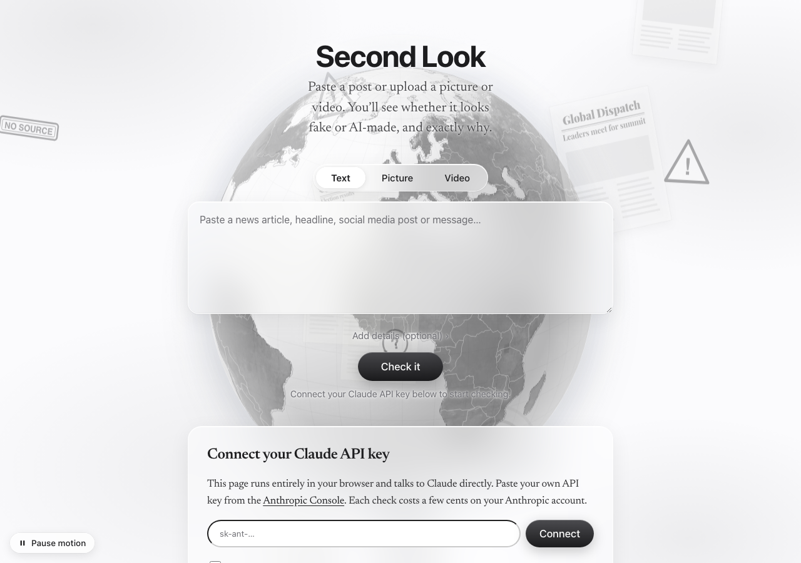

# Second Look

A fake news and AI-content checker. Paste text, or upload a picture or video clip, and get an estimate of how likely it is to be **AI-generated** and how likely it is to be **false or misleading**, with the evidence behind each number.

**Try it:** https://ehsamjo12.github.io/second-look/ (connect your own Claude API key to run checks)



> **About this project:** This is a fun side project, not a serious or research-grade tool. I built it entirely by prompt engineering with Claude Code, to test my prompts and see what I could achieve with such a powerful AI tool. Don't rely on it to decide what's true.

## Features

- **Text, picture and video checks.** Videos are checked as evenly spaced still frames (4–12).
- **A plain-language verdict** with two scores (likely fake or misleading, likely AI-generated) and how sure it is.
- **Arguments, not just labels:** each reason shows what was found in the content, why it matters, and how strong a sign it is, plus points on the other side.
- **Listen to the result:** a Listen button reads the verdict and every argument aloud, with a floating player (pause, skip section, speed) that highlights and scrolls to the part being read.
- **Comfortable editorial reading:** a news serif for everything you read, generous spacing, numbered arguments and a reading progress line.
- **Learns from verified checks:** after a check, people can say whether it turned out to be fake, real or AI-made. Future checks are shown the most similar verified cases plus a track record of past mistakes, so estimates get better over time. (The AI model itself isn't retrained; the page feeds it what it has learned.)
- **Accessible:** skip link, proper headings, keyboard-navigable tabs, screen-reader announcements when a result is ready, live captions for the audio, a natural-voice picker, a pause button for background motion, and a high-contrast mode.
- **Living background:** a textured 3D globe with news pings, plus drifting newspaper clippings, viral phone posts, forwarded chats, warning signs and "UNVERIFIED" tags that show how chaotic the information world can be.
- **A calm layout:** verdict and reasons first; extra details are folded away until you open them.
- **Flagged passages:** the exact sentences that sound AI-written or misleading are highlighted in the original text.
- **Manipulation tactics:** clickbait, false context, fake quotes, urgency, share bait and similar.
- **Text fingerprint:** sentence-length variation, word variety, all-caps and exclamation counts, urgency phrases and source cues, measured in the browser.
- **File forensics in the browser:** EXIF camera data, editing software, C2PA Content Credentials, IPTC "AI-generated" labels, and generator traces from Stable Diffusion, ComfyUI, DALL·E, Midjourney, Firefly and others.
- **Claim table** with one-click News and Fact Check Explorer searches.
- **Deep analysis mode** for a slower, more thorough check.
- **Follow-up questions** about any result.
- **Downloadable Markdown report** and a history of past checks saved in your browser.

## Use this idea

Feel free to copy, fork and remix this project. There's no framework and no build step: plain HTML, CSS and JavaScript, plus two small Python tools.

```
second-look/
├── index.html              Page markup; loads the stylesheet and scripts below
├── css/
│   └── styles.css          Glass look, editorial typography, accessibility, high-contrast mode
├── js/
│   ├── core.js             Example result, helpers, page state
│   ├── forensics.js        Text measurements and image metadata checks (run in the browser)
│   ├── render.js           Drawing the verdict, arguments, folds and history
│   ├── analysis.js         The prompts (FORMAT), running a check, follow-up chat, report export
│   ├── listen.js           Read-aloud player with captions and voice picker
│   ├── learning.js         "Did we get it right?" feedback and the track record
│   ├── standalone.js       Running outside claude.ai with a visitor's own API key
│   ├── main.js             Wiring up controls and starting the page
│   └── background.js       3D globe, news pings and floating chaos objects
├── assets/
│   ├── earth.jpg           Earth texture used by the globe (1024×512)
│   └── raw/
│       └── earth-blue-marble-4096.jpg   Original NASA Blue Marble image (4096×2048)
├── data/
│   └── countries-110m.json Country borders (TopoJSON) drawn on the globe
├── python/
│   ├── second_look.py      Command-line checker using the same prompts as the website
│   └── requirements.txt
├── tools/
│   └── build.py            Bundles everything into one HTML file (for claude.ai artifacts)
└── docs/
    └── screenshot.png
```

Good places to start:

- **The prompts:** `FORMAT` in `js/analysis.js` is how the AI is asked to argue its verdict; `lessonsFor` in `js/learning.js` is how it learns from past checks.
- **The look:** colors, glass and fonts are CSS variables at the top of `css/styles.css`.
- **The background:** `js/background.js` draws the globe and the floating objects.

## Run it yourself

Serve the folder with any static web server (opening `index.html` directly from disk works, but browsers block the globe texture and borders on `file://` pages):

```bash
python3 -m http.server 8000
# then open http://localhost:8000
```

To publish your own copy, fork this repository and turn on GitHub Pages (Settings → Pages → Deploy from branch → `main`, `/ (root)`).

## Python

**Check from the terminal.** `python/second_look.py` uses the official [Anthropic Python SDK](https://github.com/anthropics/anthropic-sdk-python) and reads its instructions from `js/analysis.js`, so the website and the command line always ask Claude the same thing.

```bash
pip install -r python/requirements.txt
export ANTHROPIC_API_KEY=sk-ant-...      # from console.anthropic.com

python python/second_look.py "BREAKING: city bans all cars tomorrow!!! SHARE before it's deleted"
python python/second_look.py --file article.txt --source "WhatsApp group"
python python/second_look.py --image photo.jpg --caption "Flooding in Paris yesterday"
python python/second_look.py --file post.txt --deep --json     # raw JSON result
```

It prints the verdict, both scores as bars, each argument with what was seen and why it matters, the other side, claims to check and how to confirm. Video isn't supported from the command line.

**Bundle into one file.** `tools/build.py` inlines the stylesheet, scripts, Earth texture and borders into `dist/second-look.html`, which works anywhere, including straight from disk:

```bash
python tools/build.py               # full HTML document
python tools/build.py --artifact    # page content only, for a claude.ai artifact
```

## How it runs

The page works in two modes from the same code:

1. **On its own (GitHub Pages or any static host).** Visitors connect their own Claude API key from the [Anthropic Console](https://console.anthropic.com/settings/keys). The page calls the Claude API straight from the browser using the official [Anthropic TypeScript SDK](https://github.com/anthropics/anthropic-sdk-typescript) (`dangerouslyAllowBrowser: true`). The key stays in that visitor's browser and is sent only to `api.anthropic.com`. Each check is billed to the visitor's own account (usually a few cents), so hosting costs nothing. Verified checks used for learning are saved in the visitor's browser.
2. **As a claude.ai artifact.** The analysis runs through the artifact runtime on the signed-in viewer's own Claude account, and verified checks are shared between everyone who can open the artifact.

**A note on API keys in the browser:** anyone who connects a key should use one with a spending limit and avoid shared computers. If you want a site where visitors don't need a key, put a small serverless proxy (for example a Cloudflare Worker) in front of the API that holds your key and rate-limits requests. That moves the cost to you.

## Limits

This is an estimate, not proof. AI detectors make mistakes in both directions. Claude doesn't search the web during a check, so it can't confirm breaking news. Video sound and motion aren't analyzed, and image metadata is often stripped by social media.

## License

MIT, see [LICENSE](LICENSE). The Earth image and border data are public domain; d3 and topojson-client are ISC-licensed and loaded from a CDN.

## Credits

- Earth imagery: NASA Blue Marble (public domain).
- Country borders: Natural Earth (public domain), via the `world-atlas` package.
- Globe rendering: [d3-geo](https://d3js.org/) and [topojson-client](https://github.com/topojson/topojson-client).
- Newspaper names in the background are invented and don't refer to real publications.
